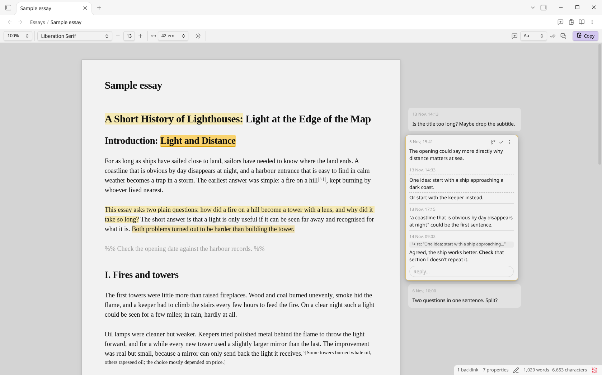
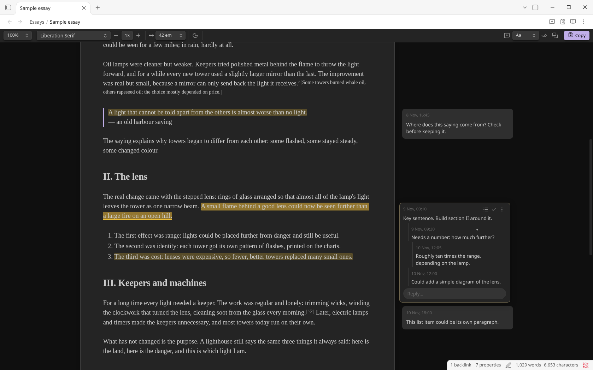

# Docs

A "Google Docs mode" for [Obsidian](https://obsidian.md): **margin comments** with replies, a **page view** with its own theme per note, and **Copy for LLM**, which hands a note, its comments and footnotes to an AI agent with nothing left implicit. Made for writing long-form text (essays, drafts) in Obsidian.



## Features

**Comments**
- Select text and add a comment. It appears as a card in the right margin, level with the text, as in Google Docs. The commented text is highlighted; overlapping comments look darker.
- Reply to the thread, or to any single comment. A reply to an earlier comment shows a small "↳ re:" chip, and a thread can be switched to a **tree view** with nested replies.
- Edit, delete, resolve (✓) and re-open. Resolved threads are hidden until you choose *Show resolved*.
- Comment bodies are Markdown; `---` on its own line becomes a separator.
- If the commented text is deleted, the thread is kept under "Detached comments".
- Narrow pane? Comments move to a **Comments sidebar**. Reading view highlights commented text too.
- **Search comments** in the sidebar (or with *Docs: Search comments*): it lists the threads whose comments contain a word and steps through them with Enter. The editor's own find (Ctrl+F) searches only the note's text, never the stored comments, and Replace never changes them.
- Double-click or right-click a comment for a menu (reply, edit, copy, go to text, resolve, delete).

**Page view** (per note, turned on with *Docs: Toggle doc mode*, or created with *Docs: Create new doc*)
- A centred page with zoom (50–200 %), page width, font and font size. Zoom scales text and width together.
- Its own page theme: *paper light*, *sepia* or *paper dark*, with sliders for page and text brightness, surround contrast and warmth. The rest of the app keeps its theme.
- A slim toolbar for all of that, plus comment actions and **Copy**.

**Copy for LLM**
- Copies the note with every comment written out: commented ranges become numbered markers `⟦c1⟧…⟦/c1⟧`, threads follow the text with dates and reply structure, footnotes are listed, embedded notes are inlined, and private `%% … %%` comments are left out. A short notation block explains the format to the agent.
- Options: include resolved threads, comments only, text only, or just the selection.

```text
<document title="Sample essay">
<notation>
⟦cN⟧…⟦/cN⟧ marks the exact text that comment thread cN refers to. Ranges may overlap or nest.
…
</notation>

## Introduction: ⟦c2⟧Light and Distance⟦/c2⟧
…
</document>

<comments>
<thread id="c2" status="open" anchor="Light and Distance">
  <comment id="c2.1" date="2026-11-05 15:41">The opening could say more directly why distance matters at sea.</comment>
  <comment id="c2.3" reply-to="c2.1" date="2026-11-13 17:15">"a coastline that is obvious by day disappears at night" could be the first sentence.</comment>
</thread>
</comments>
```

**Writing helpers:** *Insert footnote* (or jump between a footnote and its reference), *Go to next/previous heading*, *Go to next/previous comment*.



## Suggested hotkeys

Docs sets no hotkeys of its own (to avoid clashing with yours). These are the ones it was designed with; set them under **Settings → Hotkeys**, search "Docs":

| Command | Suggested |
|---|---|
| Add comment | Ctrl/Cmd + Alt + M |
| Copy for LLM | Ctrl/Cmd + Alt + C |
| Insert footnote, or jump between a footnote and its reference | Ctrl/Cmd + Alt + F |
| Go to next / previous comment | Ctrl/Cmd + Alt + . / , |
| Go to next / previous heading | Ctrl/Cmd + Alt + ↓ / ↑ |

## How your notes are stored

Everything lives **inside the note**, so it travels with the file (sync, git, copying), and the note stays readable Markdown:

- A comment's range is marked by two invisible HTML comments around the text: `<!--c:k3f9-->commented text<!--/c:k3f9-->`. Every Markdown renderer hides them.
- All threads are one JSON block at the end of the note: `<!--docs:threads { … } -->`. It is hidden in the editor and protected from accidental edits.
- Page settings are ordinary properties: `docs: true`, `docs-zoom`, `docs-width`, `docs-font`, `docs-font-size`, `docs-theme`.

Without the plugin (for example on mobile), the comment markers and the block are hidden in Reading view and visible as HTML comments in the editor.

## Privacy

Docs makes **no network requests** and collects no data. It reads and writes only the note you are working on (its comments and its `docs*` properties) and its own settings. *Copy for LLM* reads the notes you embed in the current note and writes to the clipboard only when you ask it to.

## Compatibility

Desktop only (Windows, macOS, Linux), Obsidian 1.8 or newer. Works in Live Preview and Source mode; Reading view shows highlights and uses the sidebar for comments.

Earlier versions of this plugin were called **Folio**. Notes in that format (`folio*` properties, `<!--folio:threads`) keep working and are upgraded when Docs writes to them; *Docs: Upgrade notes from the old Folio format* converts a whole vault at once.

## Installation

- **Community plugins** (once accepted): Settings → Community plugins → Browse → search "Docs".
- **Manually:** download `main.js`, `manifest.json` and `styles.css` from the [latest release](https://github.com/rodrigo-62/obsidian-docs/releases) into `<your vault>/.obsidian/plugins/docs/`, then enable *Docs* under Settings → Community plugins.

Docs writes comments into your notes: keep a backup or git history of your vault, as with any plugin that edits files.

## Development

```sh
nix develop            # dev shell with Node 22 (any Node ≥ 20 works too)
npm install
npm run dev            # watch build → test-vault/.obsidian/plugins/docs/
npm test               # vitest: core logic, headless CodeMirror, DOM smoke tests
npm run lint           # eslint-plugin-obsidianmd (Obsidian's review rules)
npm run build          # typecheck + production build into dist/
npm run vault:reset    # regenerate the sample notes in test-vault/
```

Open `test-vault/` in Obsidian (*Open folder as vault*). `npm run install-plugin -- /path/to/vault` installs a build into another vault; `npm run update-vaults` does that for every vault listed in `.install-targets` (one path per line, gitignored). `scripts/obsidian-headless.sh` runs Obsidian headless on a copy of the test vault and `scripts/cdp.mjs` drives it (evaluate JavaScript, screenshots).

Design notes: `docs/SPEC.md` (original spec), `docs/DECISIONS.md` (decisions and changes), `docs/TESTING.md` (manual checks), `docs/RESEARCH.md` (prior art).

**Releasing:** bump `version` in `manifest.json` and `package.json` (`npm version patch|minor|major` does both and updates `versions.json`), then push a tag with exactly that version (`git push --follow-tags`). The *Release* workflow tests, builds and publishes a release with `main.js`, `manifest.json` and `styles.css` (the files Obsidian installs).

## License

MIT. See `LICENSE`.
